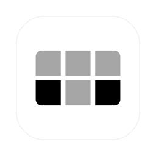

#  Tiled

Native macOS window tiling with global hotkeys. It covers quarters, sixths, and live edge resizing.

**1.0.3 · macOS 13+ · Apple Silicon + Intel · MIT**


<!-- TODO: capture demo still/GIF at ~1512x982 showing quarters + sixths -->

## Features

- Two layouts per display: quarters and sixths, switched with one key
- Eleven shared slot keys (`⌥⇧` family) that never change the layout
- Live shared-edge resizing with per-column splitters
- Independent canvases per display and per Mission Control Space
- Remappable shortcuts with visible conflict and registration states
- Undo for displacements, plus expand, evict, and splitter reset

## Install

Download `Tiled-<version>.zip` from the
[releases page](https://github.com/edrickt/tiled/releases), move `Tiled.app`
to `/Applications`, then right-click it and choose **Open** on first launch
(the bundle is ad-hoc signed, so Gatekeeper needs that one-time override).
Grant Accessibility permission when Tiled asks and relaunch. Bundles are
universal (Apple Silicon and Intel) and target macOS 13 or later.

Verify the download:

```bash
shasum -a 256 -c Tiled-<version>.zip.sha256
```

## Try it in 30 seconds

1. Focus any window and press `⌥⇧U`. It tiles into the top-left slot.
2. Press `⌥⇧⏎` to expand it, then `⌥⇧⏎` again to drop it back.
3. Press `⌥⇧\` to switch the layout on the display under the pointer,
   then `⌃⌥⇧⌘Z` to undo.
4. Open the menu bar menu for the same actions by click, including
   **Tile Focused Window** and the focused-canvas rows.

## Shortcuts

The full hotkey tables, tiling rules, and live-resizing notes live in
[docs/user-guide.md](docs/user-guide.md).

The app is the source of truth. Check menu bar → **Settings… → Shortcuts**. All
11 slot keys and 6 app actions (Expand, Evict, Reset Splitters, Switch
Layout, Settings, Undo) are remappable there; the menu names conflicts
and dead combos.

## Building & testing

```bash
swift build            # debug build
make check             # unit suite (1022 tests) and the published count
make app               # release build bundled as build/Tiled.app
```

See [docs/developing.md](docs/developing.md) for the `swift run` Accessibility note, the live suites, and the mutation gate. Grant Accessibility to Terminal during development, not to the app.

## Docs

- [User guide](docs/user-guide.md) covers hotkeys, tiling rules, and live resizing
- [Developing](docs/developing.md) covers build, test, and verification
- [Release steps](docs/release.md) cover how a version ships
- [Changelog](CHANGELOG.md) lists what changed per version

## Status

Shipped are the menu bar app, 17 hotkeys, sixths layout, live resizing,
per-Space canvases, drag-out, remappable shortcuts, and undo.
Next is owned overlay resize handles. Gaps stay out for now.

## License

Tiled is MIT-licensed. See [`LICENSE`](LICENSE).
